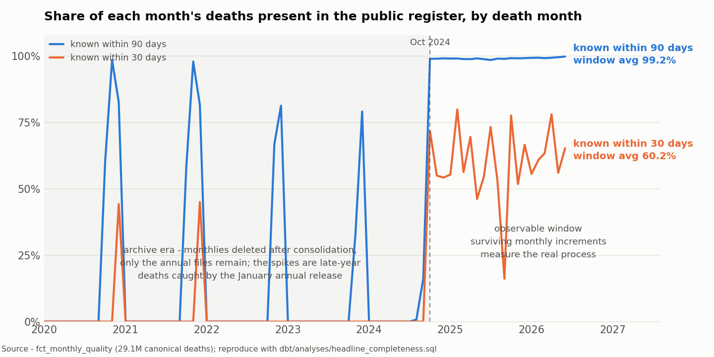
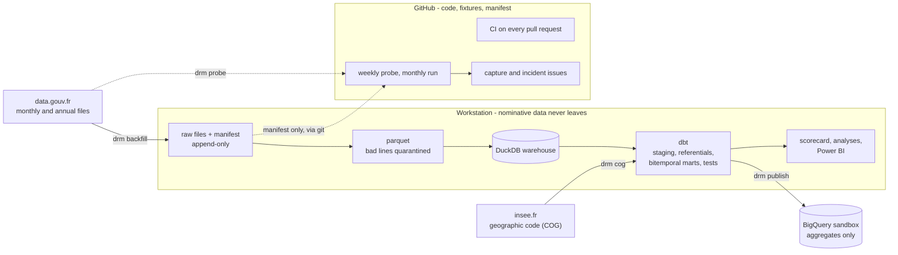

# deaths-register-monitor

How long until a death is counted, and how much does a public register
change after publication? A continuous quality audit of the French national
death register - 30 million rows since 1970, captured every month, rebuilt
in time, reconciled against the official statistics.

**99.2% of deaths reach the public register within 90 days, 60.2% within
30.** Measured on the 1,162,871 deaths of October 2024 to June 2026, the
window where the monthly deliveries still exist. Details and limits in the
[scorecard](docs/scorecard.md).

## The engineering problem

INSEE publishes the register of deceased persons on data.gouv.fr - a
fixed-width text file per year since 1970 plus a monthly increment, under
an open licence. The producer states that it cannot guarantee the file is
free of errors or omissions, and publishes no changelog. Profiling the real
files shows why that matters. Deaths arrive months or years late. Records
change between a monthly increment and the annual consolidation, without
notice. Known duplicates persist. Place codes follow a geography that has
been merging and renumbering communes since 1943. And data.gouv deletes the
monthly files once the annual file is out, so the record of what was known
when disappears with them.

The project captures every delivery before it is deleted, keeps each one
exactly as published, and rebuilds the register over two time axes - when
the death happened and when it became public. From there it measures
completeness, delays and integrity, and reconciles yearly totals with the
INSEE official series and the CépiDc counts. It runs every month without
anyone watching, and alerts when it cannot.

## Who it is for

Anyone who links data to this register - demographers, insurers and pension
funds checking deaths, anti-fraud teams, and public-health studies that use
it for vital-status follow-up. They share three questions. If I query the
register today, what share of last month's deaths will I miss? How often
does a record change after I have read it? How many lines are duplicates?
The producer's generic warning becomes measured numbers.

## Architecture

Two execution contexts (ADR-006, ADR-009). The workstation holds everything
nominative - raw files, parquet and a DuckDB warehouse of about 10 GB - and
none of it reaches GitHub or the cloud. GitHub runs the CI, a weekly probe
and a monthly control on synthetic fixtures, and only ever writes
publishable output. BigQuery receives four aggregate tables, checked
against a list of forbidden columns before upload (ADR-010).

Stack - Python 3.13 with uv, typer, pydantic and httpx, DuckDB, dbt,
GitHub Actions, Power BI, BigQuery.

## Data model

| Table | Grain - one row per | Rows |
|---|---|---:|
| `raw_deces` | source line per delivery, exactly as published | 30,190,414 |
| `dim_geo` | commune version (code and validity interval) since 1943 | 43,163 |
| `fct_death_records` | death, deduplicated, latest published version | 29,133,843 |
| `fct_record_versions` | physical record per delivery it appears in | 30,190,414 |
| `fct_completeness_triangle` | death month and knowledge date | 38,743 |
| `fct_monthly_quality` | death month | 1,352 |
| `fct_department_quality` | department and death year | 7,329 |
| `qa_reconciliation` | year, against INSEE and CépiDc | 139 |
| `fct_file_revisions` | delivery revision (from the `snap_fichiers` snapshot) | 79 |

The knowledge date is the upload date that data.gouv writes into each file
URL, so the triangle reads what was really public at each point (ADR-008).
Every fact table and the reconciliation table run under an enforced dbt
contract.

## Quality - what the checks caught

Each check below runs at every capture and build. Numbers are from the real register.

| Check | Anomaly it targets | Found |
|---|---|---|
| Fixed-width parser with quarantine (ADR-003) | line off the 176-character template | 4 lines, in the 2006 and 2007 files, isolated with their reason |
| Exact duplicate, same file | the same line published twice | 120,678 extra rows |
| Exact duplicate, across files | one line in deliveries of different periods | 6,503 lines, 221 extra rows |
| Person rule - normalised name, complete dates (ADR-007) | one person, several lines | 225,505 extra rows, within 2% of the ~221,000 found by independent analyses |
| Partial-date scope | day or month published as 00 | 115,832 rows, counted and kept out of the person rule |
| Death before birth, measured threshold of 70 | incoherent dates | 69 deaths after deduplication |
| Versioned COG resolution and `geo_exceptions` test | place code not valid on the event date | 69,598 rows (0.24%) - 10,939 empty codes, 54,155 codes used after expiry, 2,687 countries outside their validity, 1,817 rows on 939 never-published codes documented one by one |
| Version diff in `fct_record_versions` | silent correction between monthly and annual file | 97,796 deaths |
| Reconciliation with INSEE, 2.0% threshold | yearly total drifting from the official series | +0.4 to +1.6% since 1990 (scope effect), one hole in 1997 at -5.6%, about 30,000 deaths, kept as a documented exception |
| Reconciliation with CépiDc, 2.5% threshold | same, against the cause-of-death counts | +1.6 to +1.8%, stable over 2019-2024 |
| Republication snapshot | a file reissued under the same name | none observed yet, drill passed on a fabricated reissue |

Thresholds are measured values versioned as dbt variables. Any breach fails
the build - nothing is corrected silently.

## Operations

| Run | When | What it does |
|---|---|---|
| CI | every pull request | ruff, sqlfluff, 46 pytest tests, full dbt build on synthetic fixtures |
| Weekly probe | Monday 06:23 UTC | lists the data.gouv deliveries, opens a `capture` issue for any URL not in the manifest |
| Monthly run | 5th, 06:17 UTC | probe, capture SLA check, dbt build on fixtures, static docs, artifacts kept 90 days |
| Capture | on a `capture` issue, workstation | `drm backfill deaths --all-deliveries`, dbt build, `drm publish` |

A failed scheduled run opens an `incident` issue with the run link and the
runbook to follow, and the next green monthly run closes it. The alert path
was tested with a deliberate failure.

| Commitment ([docs/sla.md](docs/sla.md)) | Target |
|---|---|
| Detection | any new delivery detected within 7 days |
| Capture | captured on the workstation within 30 days of publication |
| Integrity | nothing captured is ever modified or deleted, reloads insert zero rows |
| Quality | build green, contracts included, or a visible failure |

Five failure modes are documented in
[docs/failure-modes.md](docs/failure-modes.md), with four runbooks in
[docs/runbooks](docs/runbooks/). Each runbook ends with a dated drill where
the failure was actually triggered.

Cost, measured on the BigQuery sandbox ([docs/cost.md](docs/cost.md)).
Partition pruning cuts the bytes read by about 4,800 on the triangle and 69
on the department table. The bill does not move - every query stays at the
10 MiB billing minimum, inside the free tier. The dry-run estimate ignores
clustering, so only the partition key makes cost predictable before running.

## Run it

Prerequisites - git and [uv](https://docs.astral.sh/uv/). uv installs
Python 3.13 and every dependency on first run.

**One minute, no download.** The whole pipeline on two small synthetic
deliveries with planted defects.

    git clone https://github.com/paulianne-fontoura/deaths-register-monitor.git
    cd deaths-register-monitor
    make demo

On Windows without make, run `uv run python scripts/demo.py` instead of the
last line. The demo parses and loads the two deliveries, shows that a
second load inserts nothing, builds the dbt project with its tests, then
lists what the checks caught.

**The real register, five commands.** About 20 GB of disk and two to three
hours, most of it the download and the dbt build.

    uv run drm cog
    uv run drm backfill deaths --all-deliveries
    uv run dbt build --project-dir dbt --profiles-dir dbt
    uv run dbt compile --project-dir dbt --profiles-dir dbt
    uv run python scripts/run_analysis.py headline_completeness

Other analyses are `department_extremes` and `knowledge_curve`. The Power BI
report is a versioned project in [docs/bi](docs/bi/), fed by
`uv run python scripts/export_bi.py`.

## Decisions

Architecture decision records, in French, in [docs/design/adr](docs/design/adr/).
The design document is [docs/design/000-design-doc.md](docs/design/000-design-doc.md).

| ADR | Decision |
|---|---|
| 001 | Embedded DuckDB as the production warehouse, BigQuery as a second target |
| 002 | A typed Python CLI with retries, dry-run, and tests that never call data.gouv |
| 003 | Originals kept as downloaded, parsed without cleaning, bad lines quarantined, append-only |
| 004 | One file per transaction, oldest first, annual files over monthly increments |
| 005 | Exact duplicate key and natural key for comparing deliveries |
| 006 | Nominative data on the workstation only, automation on publishable output only |
| 007 | Three measured duplicate rules, exact normalisation, no fuzzy matching in v1 |
| 008 | Bitemporal marts on the real upload dates, two-level canonical grain, measured thresholds |
| 009 | Two execution contexts, the manifest versioned as the public state of the capture |
| 010 | BigQuery gets aggregates only, integer-range partitions because the sandbox expires date partitions |

## Limits and next steps

- The knowledge axis starts with the initial upload of 9 December 2019.
  Before October 2024 the monthly files are gone, so delays there describe
  the surviving archive, not the registration process.
- Months younger than 120 days are left out of the headline - their 90-day
  share is not known yet.
- Duplicate rules use exact normalisation. The counts are a lower bound,
  fuzzy matching is left for a later version.
- Early years are partial - the 1970 file holds about 5% of that year's
  deaths.
- Capture runs on one workstation by design. A missed capture is detected
  and alerted, and a delivery deleted by data.gouv before capture is lost
  for good - it cannot be rebuilt from a fresh clone.
- BigQuery sandbox tables expire after 60 days, so publishing is part of
  the monthly capture.

Next - a post-mortem of the first real incident, the dbt documentation
online once the repository is public, and a short video walkthrough.

## Data protection and licence

This repository holds code, documentation, synthetic fixtures and aggregate
statistics only. No nominative record is ever committed or published, and
every published figure is a count, a rate or a distribution. The project
avoids any epidemiological or political reading - it measures a data
pipeline. Source data by INSEE under Licence Ouverte 2.0, with thanks for
opening it.

The design document, ADRs, runbooks and project notes are written in
French. This README and the scorecard are in English.
